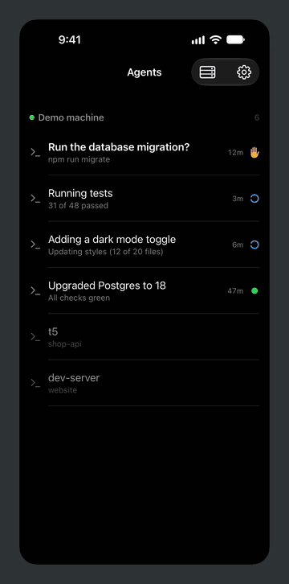
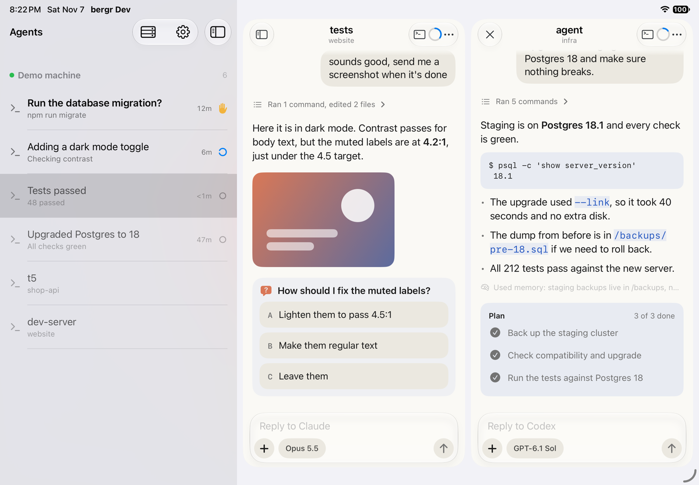
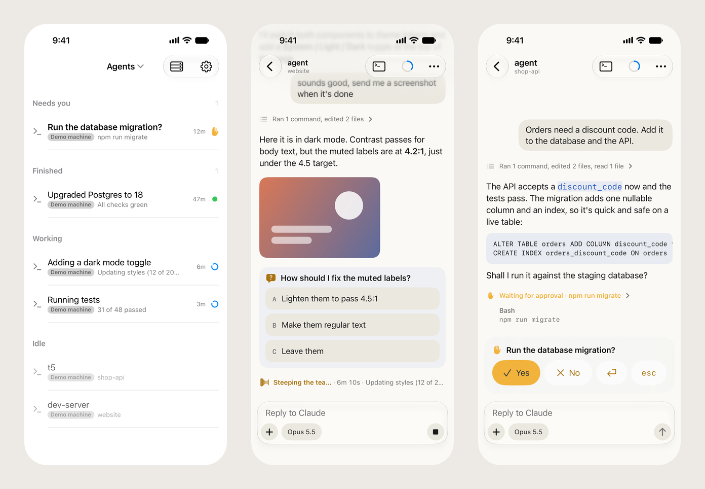

<p align="center"><picture><source media="(prefers-color-scheme: dark)" srcset="assets/logo-dark.png"></picture></p>

<h1 align="center">bergr</h1>

<p align="center">
  <strong>The shepherd for your agent herd.</strong><br>
  A native iPhone, iPad and Mac app for the coding agents that <a href="https://github.com/herdrdev/herdr">herdr</a> runs on your own machines.
</p>

<p align="center">
  <a href="https://bergr.dev">bergr.dev</a> · <a href="#building">Build it yourself</a>
</p>

<p align="center">
  <a href="assets/demo.mp4"></a>
</p>

Your coding agents run in terminals on your own machines. Bergr connects over SSH, watches every one
of them at once, shows which need you, and lets you answer in a tap. Apple Intelligence, running on
your device, sums up the work, so you read one line instead of a screen of tool output.

### On-device intelligence

Apple's on-device model (Foundation Models) writes these. The text never leaves the device. Without
Apple Intelligence, Bergr works the same and leaves the summaries out.

- **Tool-run summaries**: long tool output becomes one line in the chat, with the full output a
  tap away
- **What it's doing**: one line per working agent, saying what it is doing now, with a
  "What's It Doing?" sheet for more
- **Reply suggestions**: up to two likely next replies when an agent finishes a turn; tapping one
  fills the reply field
- **Command explainer**: before you approve a command that is hard to undo, one sentence on what
  it would do
- **Titles, changes and digests**: conversation titles, a one-sentence summary of what an agent
  changed, and a "While you were away" card
- **Alert summaries**: alerts Bergr posts itself read as one sentence about what happened

### Answer without typing

- **Permission prompts as buttons**, for Claude Code and Codex: in the chat, on notifications, and
  (while Bergr stays running) on the Lock Screen and in the Dynamic Island
- **Codex's questions** are answered from the chat, with a tap or a typed reply
- **"Always allow" rules** for commands you trust, scoped to one machine, project folder and kind
  of agent; commands that are hard to undo always ask, and you can add your own "always ask"
  patterns
- **Every answer stays** in the conversation and in an approvals log

### Every agent at a glance

- **One list across your machines**, sorted by what needs you (needs you, finished, working, idle)
  or grouped by machine, with Claude Code, Codex and Antigravity marked by their logos and their
  sub-agents counted. A machine reached both directly and through another machine's herdr-core
  shows once
- **A chat for each agent**: replies as they stream in, tool runs, plans, images, sub-agents and
  background commands the agent left running (these also show in the Agents list);
  queue a reply while it works or send it now, slash commands and skills from anywhere in a
  message, `!` shell commands, and the model, effort and permission mode from the agent's own
  model list
- **Copy what you need**: long-press a message to copy it, select part of it, copy a command in
  it, or have it read aloud
- **Claude Code updates in place**: when a machine has a newer Claude Code than a conversation
  runs, the chat offers to restart into it, keeping the conversation
- **Search and files**: search past conversations on your machines, and open a file the agent
  names in a read-only viewer
- **Machine health**: load, memory, disk and battery per machine, with low-disk and low-battery
  alerts

### Usage

- **Context and plan meters** for every running agent: the context window, the current session
  and the week
- **History charts** for the last 24 hours or 7 days, with resets marked
- **A forecast**: "At this rate you'll hit the limit at 15:10"
- **A Usage widget**, and alerts before a plan limit or a full context window

### Say it, snap it, paste it

- **Dictation** into the reply field; it stops when you pause
- **Photos and scans**: take a photo, scan a document, pick from the library or paste an image
  from the clipboard into a reply
- **Siri and Shortcuts**: "What needs me", "Send to agent", "Read the latest" and "Start session"

### Stays with you

- **A Live Activity** (also in the Apple Watch Smart Stack), Home Screen and Lock Screen widgets,
  and a Control Center button
- **Push alerts** when an agent finishes or needs you, end-to-end encrypted, from a small helper
  on each machine (macOS, Linux or Windows) that Bergr installs for you (see
  [Push alerts](#push-alerts))
- **Focus filters, quiet hours and muted agents**
- **A watchdog**: an alert when a working agent shows no output for a while, and a reminder when a
  question is still waiting

### See the work

- **Changes**: git status, a diff per file and the last test run, for everything since HEAD or
  only the last turn
- **Worktrees**: start a session in a new git worktree, and remove it when the session ends
- **A real terminal** under every chat, powered by [Ghostty](https://ghostty.org)'s libghostty-vt:
  key bar, hardware keyboards, links, scrollback and pinch to zoom

### Private and secure

- **Keys in the Secure Enclave**, optionally behind Face ID, or import your own; host keys checked
  on every connect, and connections that follow your VPN
- **No account and no tracking**. Bergr has no server of its own for your content
- **Pair an iPhone from the Mac** with a QR code: only the phone's public key crosses

No server yet? Tap **Try the Demo** on the first screen to open a built-in machine with agents to
chat with and answer. Everything in it is simulated on the device.

<p align="center">
  <picture>
    <source media="(prefers-color-scheme: dark)" srcset="assets/ipad-dark.png">
    
  </picture>
</p>

<p align="center">
  <picture>
    <source media="(prefers-color-scheme: dark)" srcset="assets/screenshot-dark.png">
    
  </picture>
</p>

## Platforms

- **iPhone and iPad**: iOS 26 or later. On the iPad and the unfolded iPhone Duo, the agents sit
  next to the conversation, and a second conversation can open beside the first.
- **Mac**: a native Mac app (macOS 26) with a menu-bar item that counts the agents that work or
  wait; the iPad app also runs on Apple silicon Macs. The native app can use your existing SSH
  config and ssh-agent: in a machine's settings, enable **Use this Mac's SSH**. No private key
  import is needed. It uses OpenSSH's `known_hosts` checks and won't show interactive SSH
  prompts; connect once in Terminal to trust a new host or unlock a key before connecting in
  Bergr. iPhone and iPad use the key selected in Bergr instead.
- **Windows hosts**: native Windows SSH hosts start `herdr-core.exe` through `cmd.exe`, preserving
  the binary protocol on stdin/stdout. Bergr finds the standard per-user installation or uses the
  executable on PATH. The chat view requires Python 3 on the host; on Windows it uses the
  standard per-user Python 3.13 installation or `python.exe` on PATH. Push alerts on Windows run
  `bergr-notify` as a Scheduled Task (at logon, current user) through the relay; no `openssl` is
  needed.

> Bergr is an independent project. It is not affiliated with or endorsed by the herdr project; it
> speaks herdr-core's public protocol.

## Building

You need a Mac with Xcode 27, [`just`](https://github.com/casey/just),
[`xcbeautify`](https://github.com/cpisciotta/xcbeautify) and [pixi](https://pixi.sh) (for the Zig
compiler that builds libghostty-vt).

```sh
git clone --recurse-submodules https://github.com/MaroonBrian1928/bergr
cd bergr
just ghostty   # builds libghostty-vt into HerdrKit/Frameworks
just sim       # runs the app in the simulator
just test      # HerdrKit tests
just video     # the README video, from the demo machine (App Store shots: just screenshots)
```

To run it on your own iPhone, sign with your team: set `BERGR_TEAM` and `BERGR_BUNDLE_ID_PREFIX`
in `.envrc.local` (see `.envrc`), then `just phone`; `just mac` installs it on this Mac. `just`
lists the other commands.

## Push alerts

Push alerts are optional (Settings → When Bergr isn't open → Notifications). When they're on, Bergr offers to install a small
helper, `bergr-notify`, on each machine: a Python script that runs as a user service (systemd on
Linux, a LaunchAgent on macOS, a Scheduled Task on Windows), follows `hc events`, and sends an
alert when an agent finishes a turn, hits an error or needs you; titles name the machine, and
alerts that need you are ordinary notifications while finished ones are passive. The alert text is
encrypted on the machine (Python standard library only, HMAC-SHA256 keystream plus tag) with a key
that only your phone holds, kept in its keychain. The relay in [`relay/`](relay) (a Cloudflare
Worker) and Apple only pass an opaque blob along.

Building it yourself, push alerts need your own relay and APNs key: deploy `relay/` as its
README describes, and point the app at it with the `bergr.push.relay` user default.

What the relay stores, and nothing else: [bergr.dev/privacy](https://bergr.dev/privacy.html).

## License

Bergr is a fork of [Hirte](https://github.com/glattziehen/hirte) by Pavel Zwerschke, used under
Apache-2.0. Bergr's changes are listed in [NOTICE](NOTICE) and in the git history.

Apache-2.0, see [LICENSE](LICENSE). Bergr ships Ghostty (libghostty-vt), Citadel, SwiftNIO (with
NIO Transport Services) and other open-source code, the JetBrains Mono and Comic Mono fonts, and
themes from iTerm2-Color-Schemes. Their licenses are in the app under Settings → Open-Source
Licenses.
