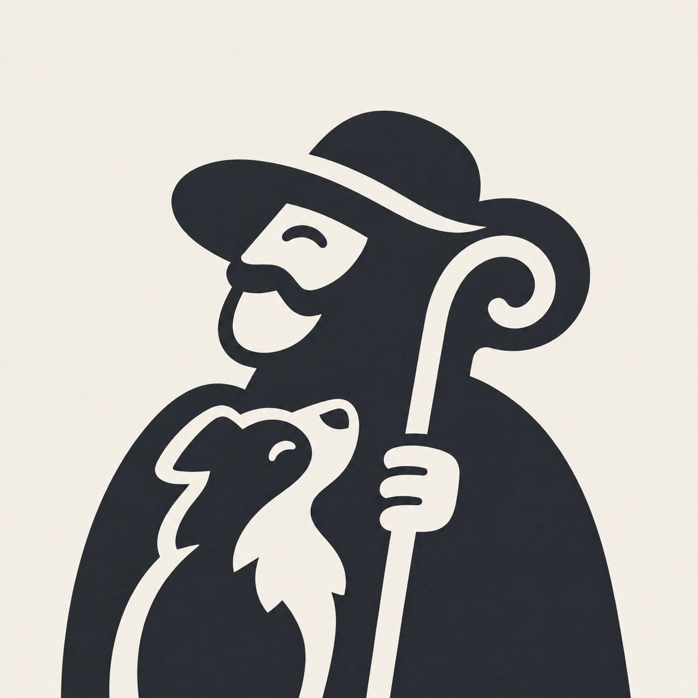
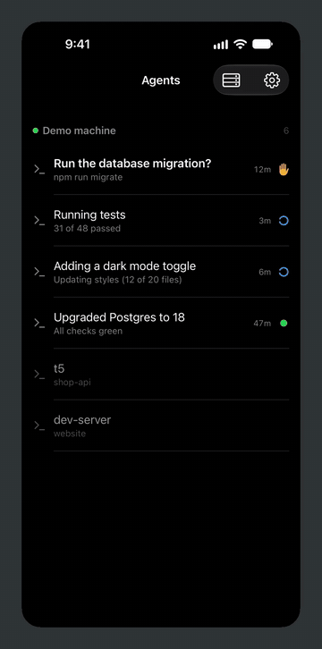
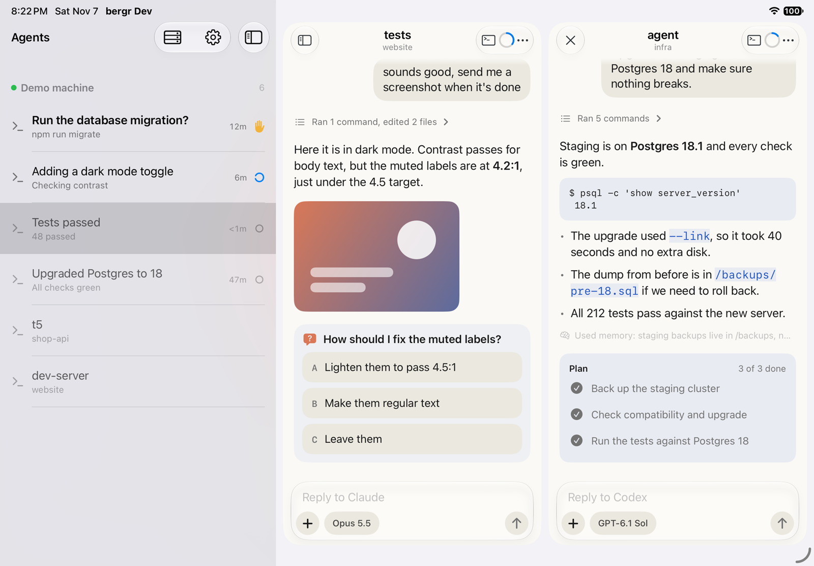
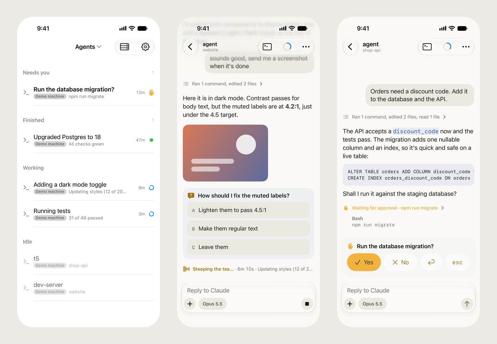

<p align="center"><picture><source media="(prefers-color-scheme: dark)" srcset="assets/logo-dark.png"></picture></p>

<h1 align="center">bergr</h1>

<p align="center">
  Your coding agents, in your pocket.<br>
  An iPhone client for <a href="https://github.com/herdrdev/herdr">herdr</a>: chat with them, answer them, and keep an eye on them from anywhere.
</p>

<p align="center">
  <a href="#building">Build it yourself</a>
</p>

<p align="center">
  <a href="assets/demo.mp4"></a>
</p>

bergr connects to your machines over SSH and shows every coding agent that herdr-core runs there,
on all of them at once: which ones are working, which are done, and which need you. Open one and you
get its conversation as a chat, with a real terminal underneath when you want it.

- **Every agent at a glance**: one list across your machines, sorted by what needs you (needs you,
  finished, working, idle) or grouped by machine, with Claude Code, Codex and Antigravity marked by
  their logos and their sub-agents counted; machines linked to another machine's herdr-core show too
- **A chat for each agent**: replies as they stream in, tool runs, plans, images and sub-agents;
  reply (or paste a screenshot), queue a reply while it works or send it now, slash commands and
  skills from anywhere in a message, `!` shell commands, switch the model, effort and permission mode, and see how full
  the context is and how much of your plan you've used
- **Answer in one tap**: an agent's question or approval becomes buttons, in the chat, on the Lock
  Screen and in the Dynamic Island; every answer stays in the conversation
- **Stays with you in the background**: a Live Activity, a Home Screen widget, and optional push
  alerts when an agent finishes or needs you, end-to-end encrypted, with a small helper on each
  machine that Bergr installs for you (see [Push alerts](#push-alerts))
- **A real terminal**, powered by [Ghostty](https://ghostty.org)'s libghostty-vt: key bar, hardware
  keyboards, links, scrollback and pinch to zoom
- **Keys in the Secure Enclave**, optionally behind Face ID, or import your own; host keys checked
  on every connect, and connections that follow your VPN

On the iPad and the unfolded iPhone Duo, the agents sit next to the conversation, and a second
conversation can open beside the first. It works on every iPhone and iPad with iOS 26 or later, and
on Apple silicon Macs as an iPad app.

<p align="center">
  <picture>
    <source media="(prefers-color-scheme: dark)" srcset="assets/ipad-dark.png">
    
  </picture>
</p>

<p align="center">
  <picture>
    <source media="(prefers-color-scheme: dark)" srcset="assets/screenshot-dark.png">
    
  </picture>
</p>

> Bergr is an independent project. It is not affiliated with or endorsed by the herdr project; it
> speaks herdr-core's public protocol.

## Building

You need a Mac with Xcode 27, [`just`](https://github.com/casey/just),
[`xcbeautify`](https://github.com/cpisciotta/xcbeautify) and [pixi](https://pixi.sh) (for the Zig
compiler that builds libghostty-vt).

```sh
git clone --recurse-submodules https://github.com/MaroonBrian1928/bergr
cd bergr
just ghostty   # builds libghostty-vt into HerdrKit/Frameworks
just sim       # runs the app in the simulator
just test      # HerdrKit tests
just video     # the README video and screenshots, from the demo machine
```

To run it on your own iPhone, sign with your team: set `BERGR_TEAM` and `BERGR_BUNDLE_ID_PREFIX`
in `.envrc.local` (see `.envrc`), then `just phone`; `just mac` installs it on this Mac. `just`
lists the other commands.

## Push alerts

Push alerts are optional (Settings → Push alerts). When they're on, Bergr offers to install a small
helper, `bergr-notify`, on each machine: a Python script that runs as a user service (systemd on
Linux, a LaunchAgent on macOS), follows `hc events`, and sends an alert when an agent finishes a
turn or needs you. The alert text is encrypted on the machine with a key only your phone holds;
the relay in [`relay/`](relay) (a Cloudflare Worker) and Apple only pass an opaque blob along.

Building it yourself, push alerts need your own relay and APNs key: deploy `relay/` as its
README describes, and point the app at it with the `bergr.push.relay` user default.

## License

Bergr is a fork of [Hirte](https://github.com/glattziehen/hirte) by Pavel Zwerschke, used under
Apache-2.0. Bergr's changes are listed in [NOTICE](NOTICE) and in the git history.

Apache-2.0, see [LICENSE](LICENSE). Bergr ships Ghostty (libghostty-vt), Citadel, SwiftNIO (with
NIO Transport Services) and
other open-source code, the JetBrains Mono and Comic Mono fonts, and themes from
iTerm2-Color-Schemes; their licenses are in the app under Settings → Open-Source Licenses.
